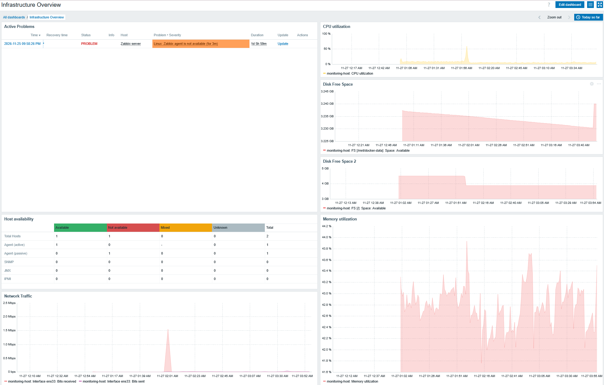
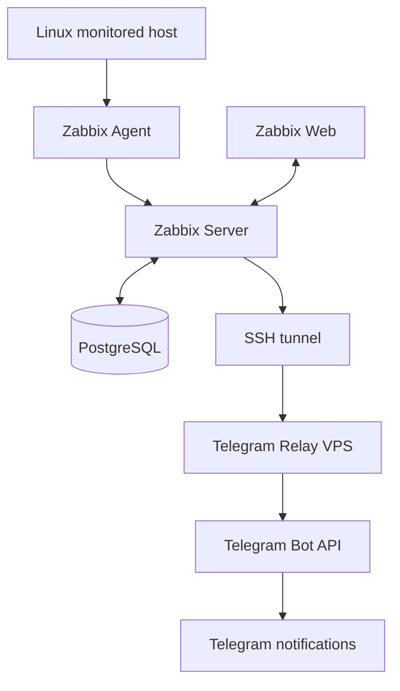
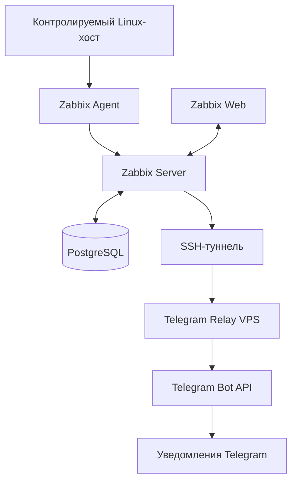

# Infrastructure Monitoring

## Contents

- [Overview](#overview)
- [Architecture](#architecture)
- [Technology stack](#technology-stack)
- [Monitoring capabilities](#monitoring-capabilities)
- [Deployment](#deployment)
- [Configuration](#configuration)
- [Validation](#validation)
- [Documentation](#documentation)

## Overview

Infrastructure monitoring project based on Zabbix 7.4, PostgreSQL, Docker Compose, and a separate Telegram notification relay.

The project demonstrates centralized Linux host monitoring, web service availability checks, trigger configuration, and automated notification delivery for problem and recovery events.



## Architecture

The monitoring environment consists of the following components:

- **Zabbix Agent** collects system metrics from the monitored Linux host.
- **Zabbix Server** processes collected data, evaluates trigger expressions, and generates events.
- **PostgreSQL** stores monitoring configuration and historical data.
- **Zabbix Web** provides a dashboard for monitoring metrics, problems, and host availability.
- **Telegram Relay** forwards requests to the Telegram Bot API from a separate server.
- **SSH tunnel** provides connectivity between Zabbix Server and Telegram Relay.



## Technology stack

| Component | Technology |
|---|---|
| Monitoring | Zabbix 7.4 |
| Database | PostgreSQL 16 |
| Containerization | Docker |
| Container orchestration | Docker Compose |
| Operating system | Linux |
| Monitoring agent | Zabbix Agent |
| Relay service | Python 3 |
| Secure connectivity | SSH tunnel |
| Notifications | Telegram Bot API |

## Monitoring capabilities

The project provides monitoring for:

- CPU utilization and threshold violations.
- Memory utilization.
- Filesystem capacity and available disk space.
- Network traffic across network interfaces.
- Monitored host availability.
- Zabbix frontend availability through a web scenario.
- Telegram notifications for problem and recovery events.

### Trigger thresholds

| Check | Condition | Severity |
|---|---|---|
| CPU utilization | Above 80% | Warning |
| Root filesystem usage | Above 90% | Warning |
| Zabbix frontend availability | HTTP status is not 200 | High |

## Deployment

Clone the repository and prepare the environment file:

```bash
git clone <repository-url>
cd infrastructure-monitoring
cp .env.example .env
```

Edit `.env` and set a strong PostgreSQL password. Then start the services:

```bash
docker compose pull
docker compose up -d
```

Check service status:

```bash
docker compose ps
```

Open the Zabbix frontend:

```text
http://<server-address>:8080/
```

The deployment uses a persistent Docker volume for PostgreSQL data.

## Configuration

The repository includes:

- `compose.yaml` — Docker Compose deployment.
- `.env.example` — environment variable template.
- `monitoring/monitoring-host.yaml` — exported Zabbix host configuration, web scenario, macros, and triggers.
- `telegram-relay/relay.py` — Telegram API relay implementation.
- `docs/dashboard.md` — monitoring configuration and screenshots.

The `.env` file, credentials, and private connectivity test scripts are excluded from version control.

The Telegram relay is designed to run on a separate server. Its connectivity to the monitoring host is provided through an SSH tunnel.

## Validation

The deployment was tested using controlled monitoring events:

- CPU threshold violation and trigger activation.
- HTTP error simulation in the frontend availability scenario.
- Trigger recovery after restoring normal conditions.
- Telegram PROBLEM and RECOVERY notification delivery.
- Zabbix media type test.

## Documentation

Detailed monitoring configuration and screenshots:

- [Infrastructure Overview Dashboard](docs/dashboard.md)
- [Zabbix host export](monitoring/monitoring-host.yaml)

---

# Мониторинг инфраструктуры

## Содержание

- [Обзор](#обзор)
- [Архитектура](#архитектура)
- [Технологический стек](#технологический-стек)
- [Возможности мониторинга](#возможности-мониторинга)
- [Развёртывание](#развёртывание)
- [Конфигурация](#конфигурация)
- [Проверка работоспособности](#проверка-работоспособности)
- [Документация](#документация)

## Обзор

Проект представляет собой систему мониторинга инфраструктуры на базе Zabbix 7.4, PostgreSQL, Docker Compose и отдельного сервиса пересылки уведомлений в Telegram.

Решение демонстрирует развёртывание централизованного мониторинга Linux-хоста, контроль доступности веб-интерфейса, настройку триггеров и доставку уведомлений о возникновении и устранении проблем.


## Архитектура

Система состоит из следующих компонентов:

- **Zabbix Agent** собирает системные метрики контролируемого Linux-хоста.
- **Zabbix Server** обрабатывает метрики, проверяет условия триггеров и формирует события.
- **PostgreSQL** хранит конфигурацию и историю мониторинга.
- **Zabbix Web** предоставляет интерфейс для просмотра метрик, проблем и состояния хостов.
- **Telegram Relay** пересылает запросы к Telegram Bot API с отдельного сервера.
- **SSH-туннель** обеспечивает соединение между Zabbix Server и Telegram Relay.



## Технологический стек

| Компонент | Технология |
|---|---|
| Мониторинг | Zabbix 7.4 |
| База данных | PostgreSQL 16 |
| Контейнеризация | Docker |
| Оркестрация контейнеров | Docker Compose |
| Операционная система | Linux |
| Агент мониторинга | Zabbix Agent |
| Сервис пересылки | Python 3 |
| Защищённое соединение | SSH-туннель |
| Уведомления | Telegram Bot API |

## Возможности мониторинга

Настроен мониторинг следующих показателей и событий:

- Загрузка процессора и контроль превышения порогового значения.
- Использование оперативной памяти.
- Свободное место на файловой системе.
- Сетевой трафик по сетевым интерфейсам.
- Доступность контролируемого хоста.
- Доступность веб-интерфейса Zabbix с помощью web-сценария.
- Отправка уведомлений в Telegram при возникновении и устранении проблем.

### Пороговые значения триггеров

| Проверка | Условие | Уровень |
|---|---|---|
| Загрузка CPU | Более 80% | Warning |
| Использование корневой файловой системы | Более 90% | Warning |
| Доступность веб-интерфейса | HTTP-статус отличается от 200 | High |

## Развёртывание

Клонируйте репозиторий и подготовьте файл переменных окружения:

```bash
git clone <repository-url>
cd infrastructure-monitoring
cp .env.example .env
```

Укажите надёжный пароль PostgreSQL в `.env`, затем загрузите образы и запустите сервисы:

```bash
docker compose pull
docker compose up -d
```

Проверьте состояние контейнеров:

```bash
docker compose ps
```

Веб-интерфейс Zabbix будет доступен по адресу:

```text
http://<server-address>:8080/
```

Данные PostgreSQL сохраняются в постоянном Docker volume.

## Конфигурация

В репозитории представлены:

- `compose.yaml` — конфигурация развёртывания Docker Compose.
- `.env.example` — шаблон переменных окружения.
- `monitoring/monitoring-host.yaml` — экспорт конфигурации хоста Zabbix, web-сценария, макросов и триггеров.
- `telegram-relay/relay.py` — реализация сервиса пересылки запросов к Telegram Bot API.
- `docs/dashboard.md` — описание конфигурации мониторинга и скриншоты.

Файл `.env`, учётные данные и приватные тестовые скрипты исключены из системы контроля версий.

Telegram Relay рассчитан на работу на отдельном сервере. Соединение с сервером мониторинга организовано через SSH-туннель.

## Проверка работоспособности

Работа системы проверялась с помощью контролируемых событий:

- Искусственное превышение порога загрузки CPU и срабатывание триггера.
- Имитация HTTP-ошибки в сценарии проверки доступности веб-интерфейса.
- Восстановление триггера после возврата нормальных условий.
- Доставка уведомлений Telegram типов PROBLEM и RECOVERY.
- Проверка канала уведомлений через тестирование Media type в Zabbix.

## Документация

Подробная конфигурация мониторинга и скриншоты:

- [Панель мониторинга и настройки Zabbix](docs/dashboard.md)
- [Экспорт конфигурации контролируемого хоста](monitoring/monitoring-host.yaml)
