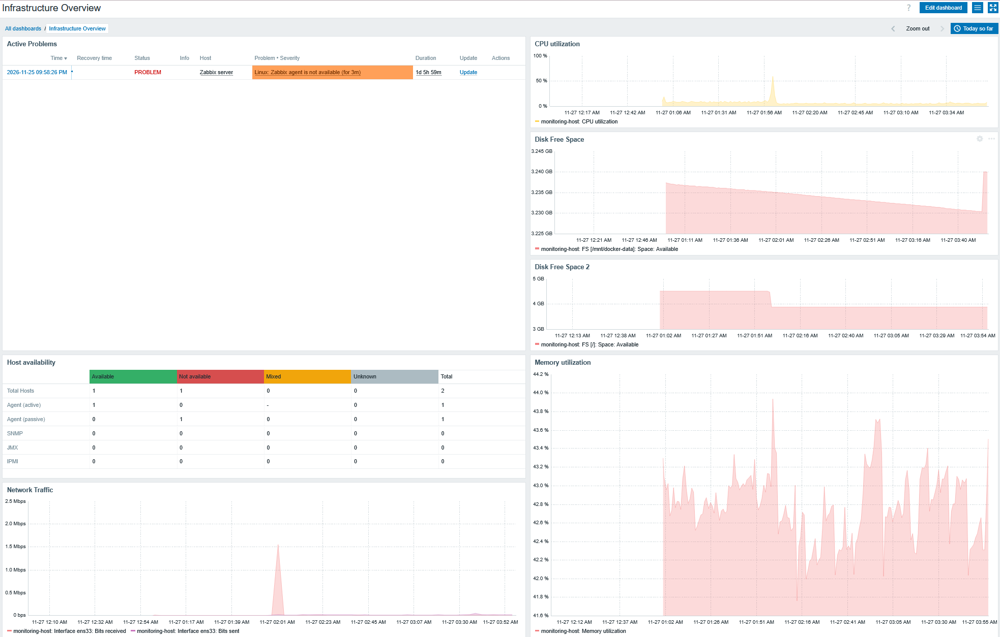
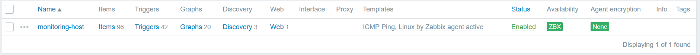
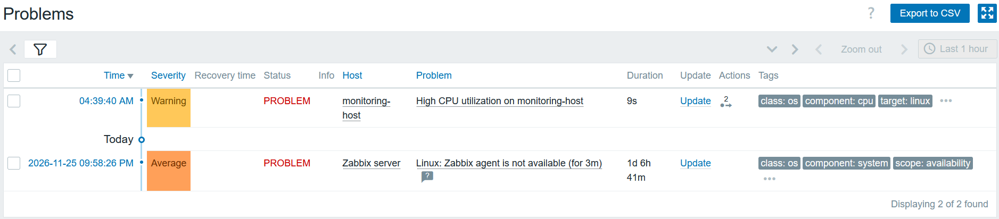
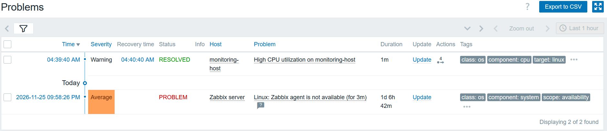
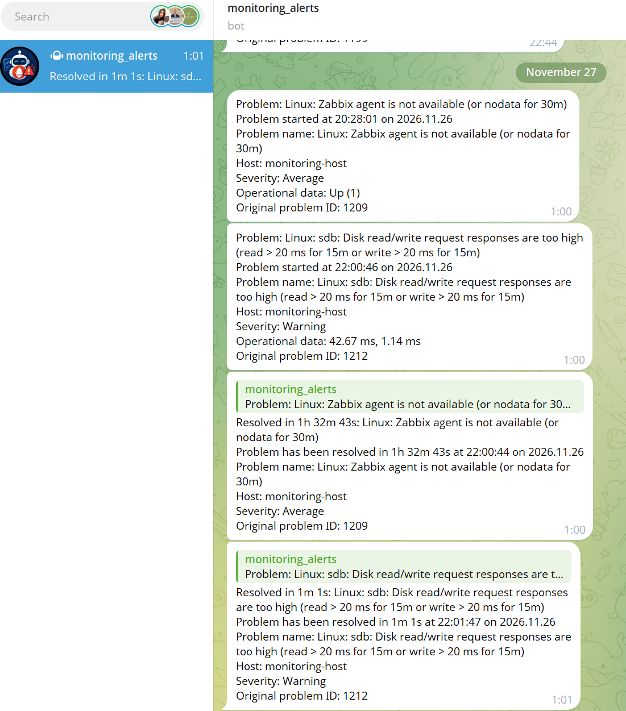
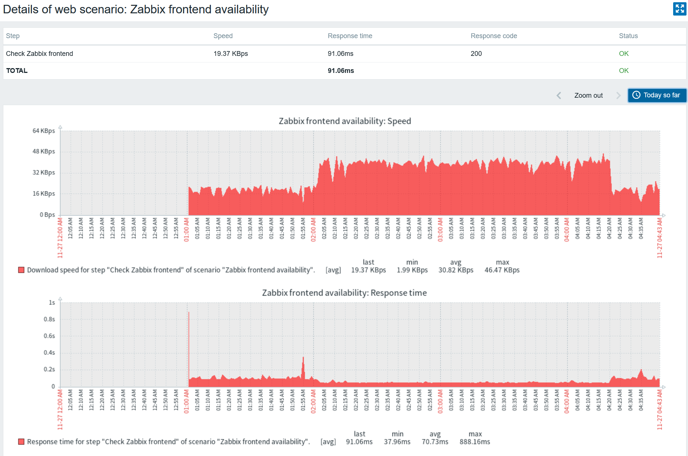

# Infrastructure Overview Dashboard

## Contents
- [Overview](#overview)
- [Monitored host](#monitored-host)
- [Dashboard widgets](#dashboard-widgets)
- [Monitoring thresholds](#monitoring-thresholds)
- [Alert scenarios](#alert-scenarios)
- [Web availability check](#web-availability-check)
- [Validation](#validation)

## Overview

The Infrastructure Overview dashboard provides a centralized view of the monitored Linux infrastructure using Zabbix 7.4.

It helps an administrator identify availability issues, resource utilization anomalies, and active problems from a single interface.

## Monitored host

The project monitors a Linux server named `monitoring-host` using Zabbix agent active checks and ICMP availability monitoring.

The host is assigned the following templates:
- Linux by Zabbix agent active
- ICMP Ping

## Dashboard widgets

| Widget | Purpose |
|---|---|
| Problems | Displays active monitoring problems |
| Host availability | Shows monitored host availability |
| CPU utilization | Tracks processor utilization |
| Memory utilization | Tracks memory consumption |
| Disk free space | Monitors available filesystem capacity |
| Network traffic | Displays network interface traffic |

## Monitoring thresholds

| Metric | Threshold | Severity |
|---|---:|---|
| CPU utilization | Above 80% | Warning |
| Root filesystem usage | Above 90% | Warning |

The CPU trigger uses a one-minute minimum utilization value. The root filesystem warning threshold is configured through a host macro.

## Alert scenarios

The monitoring configuration includes the following scenarios:

- High CPU utilization.
- Zabbix frontend unavailable.
- ICMP host availability.
- Filesystem capacity monitoring.
- Network interface status and traffic.

Telegram is configured as the notification channel for PROBLEM and RECOVERY events.

## Web availability check

A Zabbix web scenario named `Zabbix frontend availability` checks the frontend over HTTP.

The scenario contains a step named `Check Zabbix frontend` and expects HTTP status code 200. The URL uses the Docker Compose service name `zabbix-web`, allowing the check to run inside the Compose network.

## Validation

The monitoring configuration was validated through controlled tests:

- CPU utilization threshold violation.
- HTTP error in the frontend availability scenario.
- Trigger recovery after restoring normal conditions.
- Telegram notification delivery using the Zabbix media type test.

The tests confirmed problem detection, recovery event generation, and notification delivery.

---

# Панель мониторинга Infrastructure Overview

## Содержание
- [Обзор](#обзор)
- [Контролируемый хост](#контролируемый-хост)
- [Виджеты панели](#виджеты-панели)
- [Пороговые значения мониторинга](#пороговые-значения-мониторинга)
- [Сценарии оповещения](#сценарии-оповещения)
- [Проверка доступности веб-интерфейса](#проверка-доступности-веб-интерфейса)
- [Проверка работоспособности](#проверка-работоспособности)

## Обзор

Панель Infrastructure Overview предоставляет централизованное представление состояния контролируемой Linux-инфраструктуры средствами Zabbix 7.4.

Она позволяет администратору обнаруживать проблемы доступности, аномалии потребления ресурсов и активные инциденты в одном интерфейсе.

## Контролируемый хост

В проекте настроен мониторинг Linux-сервера `monitoring-host` с использованием активных проверок Zabbix agent и контроля доступности по ICMP.

К хосту привязаны шаблоны:
- Linux by Zabbix agent active
- ICMP Ping

## Виджеты панели

| Виджет | Назначение |
|---|---|
| Problems | Отображение активных проблем мониторинга |
| Host availability | Отображение доступности контролируемого хоста |
| CPU utilization | Мониторинг загрузки процессора |
| Memory utilization | Мониторинг использования оперативной памяти |
| Disk free space | Контроль свободного места в файловых системах |
| Network traffic | Отображение сетевого трафика интерфейсов |

## Пороговые значения мониторинга

| Метрика | Порог | Уровень важности |
|---|---:|---|
| Загрузка CPU | Более 80% | Warning |
| Использование корневой файловой системы | Более 90% | Warning |

Триггер CPU использует минимальное значение загрузки за одну минуту. Порог предупреждения для корневой файловой системы задаётся через макрос хоста.

## Сценарии оповещения

Конфигурация мониторинга включает следующие сценарии:

- Повышенная загрузка CPU.
- Недоступность веб-интерфейса Zabbix.
- Доступность хоста по ICMP.
- Контроль заполнения файловых систем.
- Состояние сетевых интерфейсов и сетевой трафик.

Telegram используется для отправки уведомлений о событиях PROBLEM и RECOVERY.

## Проверка доступности веб-интерфейса

Сценарий `Zabbix frontend availability` проверяет доступность веб-интерфейса по HTTP.

Он содержит шаг `Check Zabbix frontend` и ожидает HTTP-код 200. В URL используется имя Docker Compose-сервиса `zabbix-web`, поэтому проверка выполняется внутри сети Compose.

## Проверка работоспособности

Конфигурация мониторинга проверялась с помощью контролируемых тестов:

- Искусственное превышение порога загрузки CPU.
- Создание HTTP-ошибки в сценарии проверки доступности веб-интерфейса.
- Проверка восстановления триггеров после возврата нормальных условий.
- Проверка доставки уведомлений через тест Media type в Zabbix.

Тестирование подтвердило обнаружение проблем, генерацию событий восстановления и доставку уведомлений.
